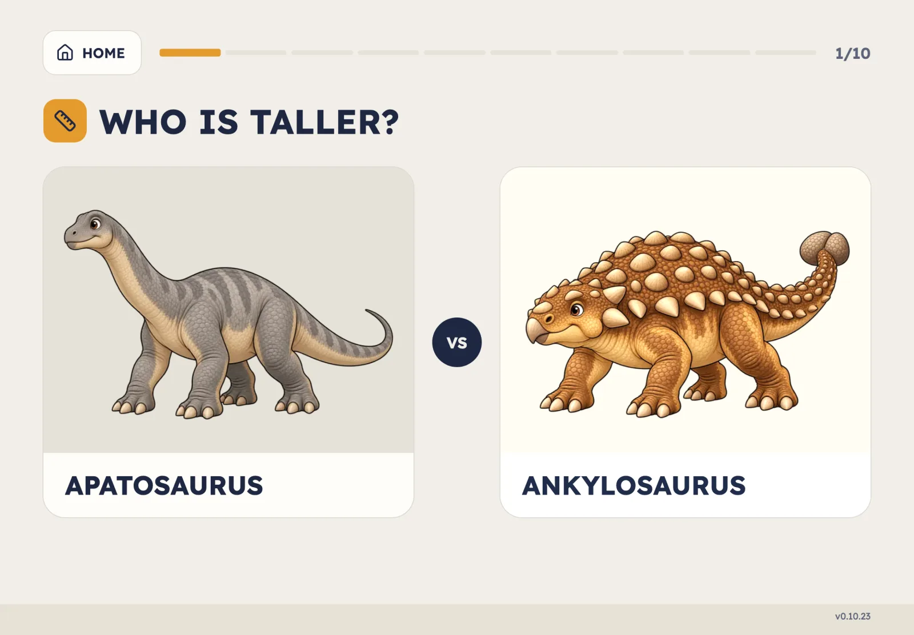
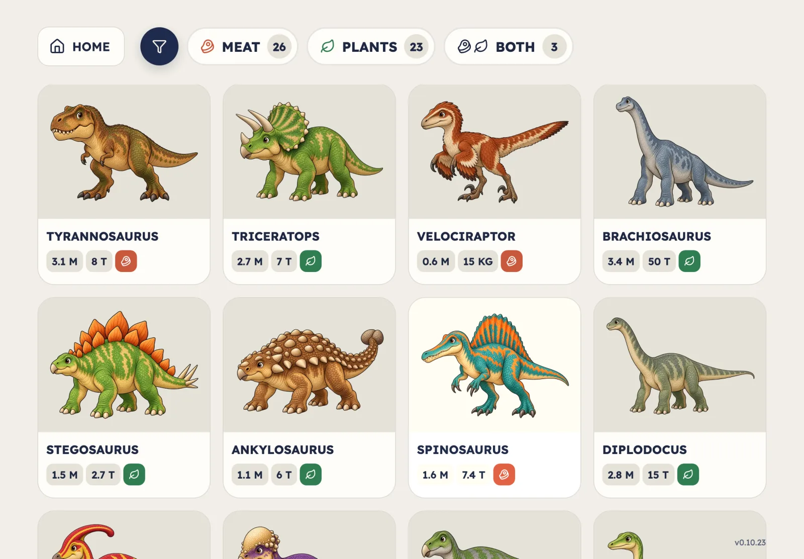
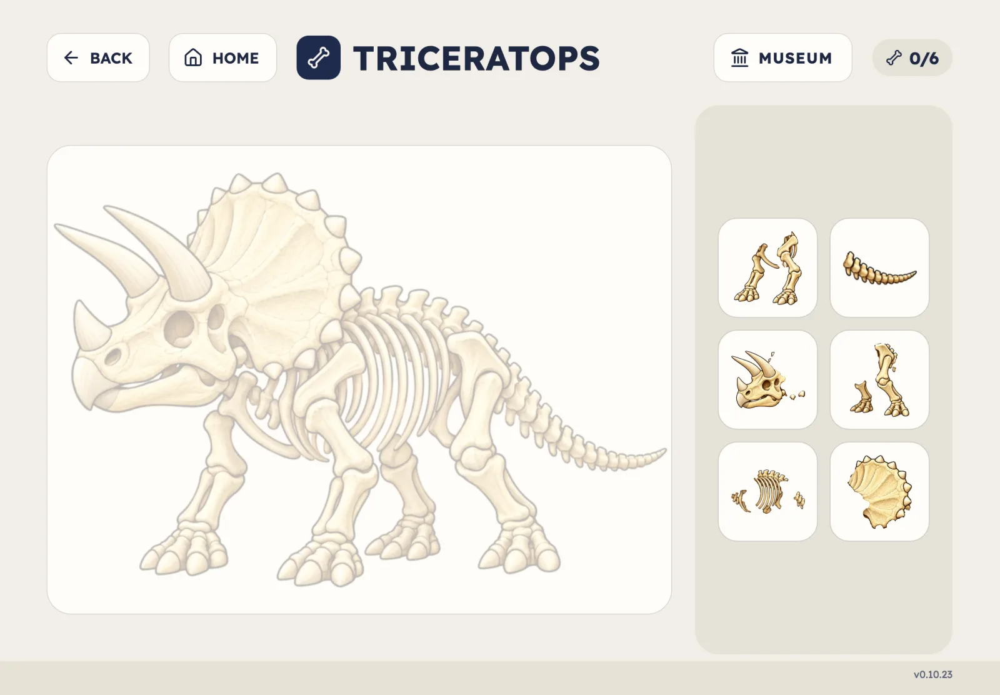
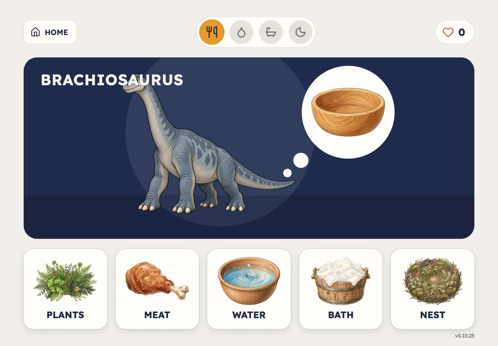
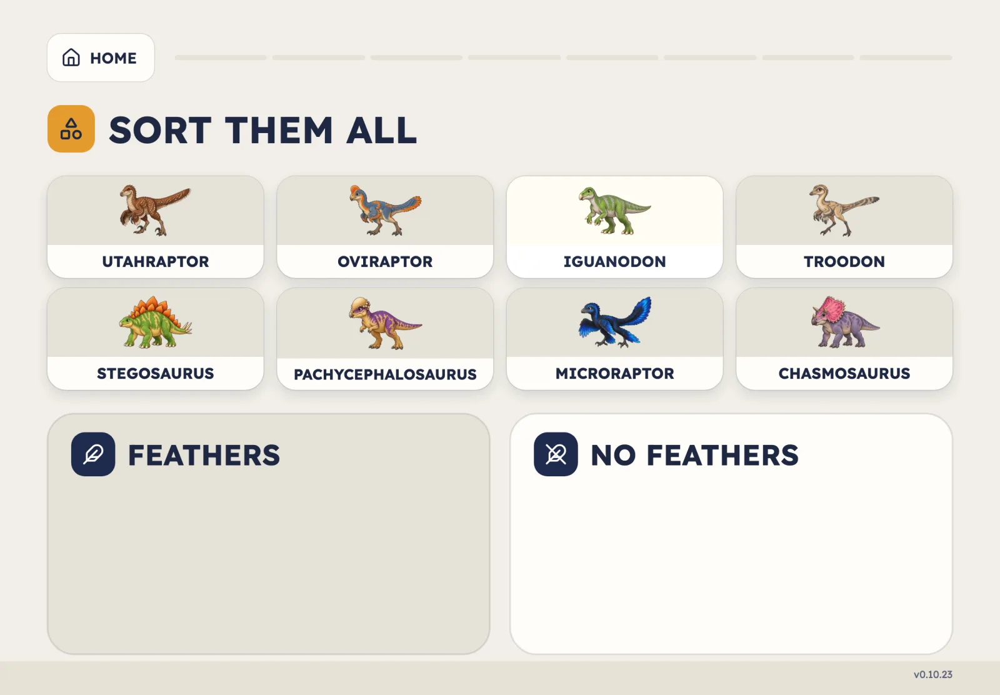
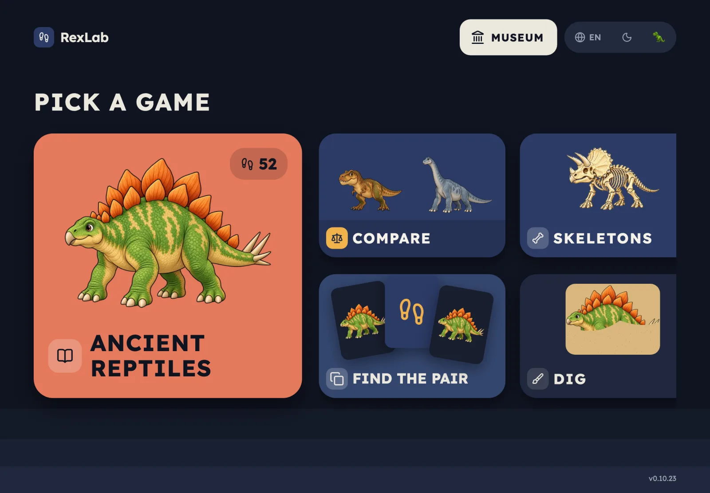

# RexLab

A dinosaur learning web app for children aged 4 to 7, made for an iPad held
sideways. Play it at **[rexlab.enoa.ai](https://rexlab.enoa.ai)**.


## The games

| | |
|---|---|
|  | **Compare.** Who is heavier, taller, longer? Ten questions a round, with a celebration for a new best score. |
|  | **Ancient reptiles.** A catalogue of 52 dinosaurs, flying and sea reptiles, filtered by what they ate, with facts checked against natural history museums and Britannica. |
|  | **Skeletons.** Put a skeleton together from its bones, then guess a mystery dinosaur by its bones alone. Finished skeletons go to the museum. |
|  | **Care.** A dinosaur visits hungry, thirsty, dirty or tired; give it what it needs and make a friend. |
|  | **Sort them all.** Drag dinosaurs into the right basket: two legs or four, meat or plants, horns, feathers, big or small. |

Also **Find the pair**, a memory game, and **Dig**, where a child brushes sand
away to uncover fossils and treasures.

Every game has three age levels (Hatchling, Explorer, Paleontologist). The app
is in English and Russian, with text for children in capitals, and has light
and dark themes.



## How it is built

- React 19, TypeScript and Vite; no backend. Progress stays in the browser's
  local storage.
- Behaviour is specified first, in Gherkin: 87 feature files with about 640
  scenarios in [`docs/features/`](docs/features/).
- 130+ Vitest test files cover the games' rules, layout fit at real iPad
  window sizes, tap safety for small hands, and the architecture's own rules.
- Built with AI coding agents working from those specs and tests. The
  dinosaur, skeleton and item artwork is AI-generated; each picture's
  generator is recorded in a `CREDITS.md` beside it.

## Running it

```sh
npm ci
npm run dev        # local server
npm test           # the test suite
npm run typecheck
npm run build
```

`sh scripts/test.sh` runs the whole check: clean install, typecheck, tests and
build.

## About this repository

This is a published snapshot of a project developed in a private monorepo.
Issues are welcome; pull requests may not be merged here.

## License

[MIT](LICENSE)
